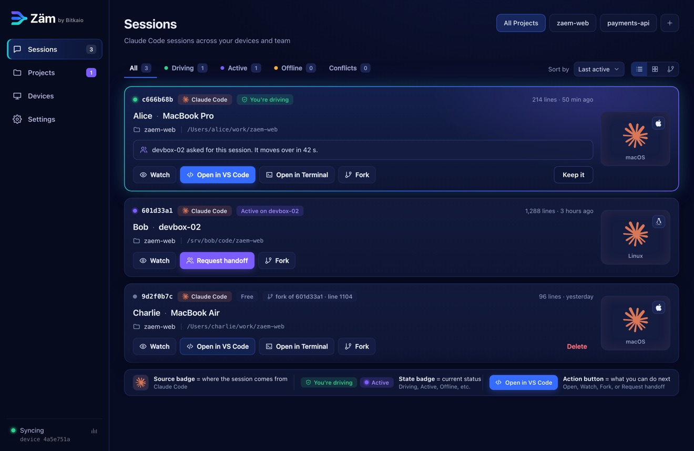
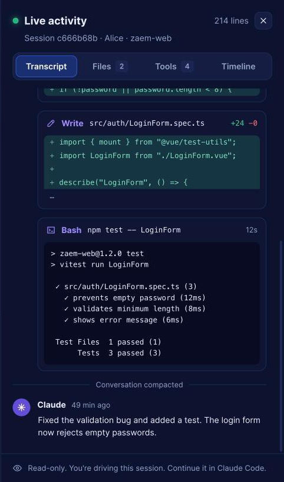
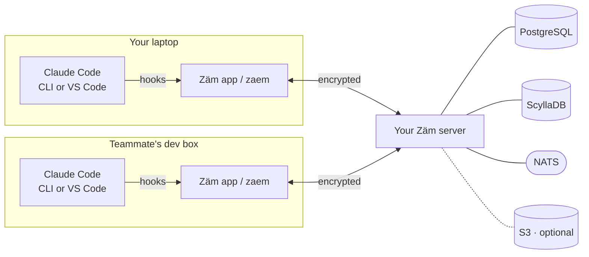

<div align="center">

<a href="https://zaem.ch"></a>

# Zäm

**Continue Claude Code sessions across machines and teammates.**

Zäm syncs your Claude Code sessions as you work, so you or a teammate can pick one up on any computer, from exactly where it stopped.

[](https://github.com/zaem-ai/zaem-ai/releases/latest)
[](https://github.com/zaem-ai/zaem-ai/releases)
[](#download)
[](https://code.claude.com/docs/en/overview)
[](#run-the-server)
[](#faq)

[**Website**](https://zaem.ch) · [**Download**](#download) · [**Docs**](https://zaem.ch/docs) · [**Self-hosting**](https://zaem.ch/docs/self-hosting) · [**Security**](https://zaem.ch/docs/security)

<br>



</div>

<br>

## Built for ourselves. Shared with you.

At [Bitkaio](https://waeg.ai/about) we work with Claude Code all day, across laptops, dev boxes and each other. Moving a session meant copying context around and losing the thread. So we built Zäm for our own team, and it quickly became part of how we work: we hand sessions over, pick them up on another machine and follow each other's work as it happens.

It helps us so much that we decided to share it. Zäm is free, it runs on your own infrastructure, and it is the same tool we use every day.

## What it does

<table>
<tr>
<td width="50%" valign="top">

**⚡ Live session sync**<br>
Every Claude Code session in a linked repository syncs while you work, across all your computers and your team.

</td>
<td width="50%" valign="top">

**🤝 Seamless handoffs**<br>
Ask for a session someone else is driving. It moves over when their turn ends, with the full context.

</td>
</tr>
<tr>
<td valign="top">

**💻 Multi-device continuity**<br>
Start on your laptop, continue on a dev box from exactly the same point, with long tool outputs, `/rewind` history and Claude's memory of the repo.

</td>
<td valign="top">

**🔒 One driver at a time**<br>
A lock per session means two windows never write over each other. Lines written offline are kept as a copy.

</td>
</tr>
<tr>
<td valign="top">

**👀 Live transcript**<br>
Watch a session read-only while it runs: messages, tool calls, diffs and command output.

</td>
<td valign="top">

**🌿 Fork sessions**<br>
Branch off any session, even one that is in use, to try another direction without touching the original.

</td>
</tr>
<tr>
<td valign="top">

**📦 Code state travels too**<br>
Encrypted checkpoints of your uncommitted changes, restored into a clean checkout when someone continues.

</td>
<td valign="top">

**🧩 CLI and VS Code**<br>
Works with the Claude Code CLI and the VS Code extension through a plugin. No change to how you work.

</td>
</tr>
</table>

<table>
<tr>
<td width="62%" valign="top">

### Watch, learn and build together

Open any session read-only and follow it live: prompts, answers, tool calls, edits with their diffs and test output. Good for pairing, reviews and onboarding, and for picking up exactly where someone left off.

- Live transcript with edits, commands and results
- Files changed and tools used, at a glance
- Decrypted on your computer, never on the server

### Pass the keyboard, keep the momentum

A teammate asks for the session, and it moves over as soon as the current turn ends. They continue in their own checkout, with the whole conversation and, if you like, your uncommitted changes. One click in the app, or `zaem handoff`.

</td>
<td width="38%" valign="top" align="center">



</td>
</tr>
</table>

## How it works



1. **Link a repository** once (`zaem link`, or *Projects → Link a folder* in the app).
2. **Work as usual.** A Claude Code plugin hooks into every session in that repository. Zäm encrypts it on your computer and syncs it as you go.
3. **Continue anywhere.** Open the session on another computer, in another checkout path, or hand it to a teammate. Claude continues from exactly the same point.

A lock per session keeps one window in charge. Any other window can read along, and prompts there are blocked with a message saying what to do next.

## Download

The desktop app runs the sync in the background (menu bar or system tray), shows your team's sessions and bundles the `zaem` command line.

| System | Desktop app | Command line only |
| --- | --- | --- |
| **macOS** · Apple Silicon | [Zaem-macos-arm64.dmg](https://github.com/zaem-ai/zaem-ai/releases/latest/download/Zaem-macos-arm64.dmg) | [zaem-macos-arm64.tar.gz](https://github.com/zaem-ai/zaem-ai/releases/latest/download/zaem-macos-arm64.tar.gz) |
| **macOS** · Intel | [Zaem-macos-x64.dmg](https://github.com/zaem-ai/zaem-ai/releases/latest/download/Zaem-macos-x64.dmg) | [zaem-macos-x64.tar.gz](https://github.com/zaem-ai/zaem-ai/releases/latest/download/zaem-macos-x64.tar.gz) |
| **Windows** · x64 | [Installer (.exe)](https://github.com/zaem-ai/zaem-ai/releases/latest/download/Zaem-windows-x64-setup.exe) · [.msi](https://github.com/zaem-ai/zaem-ai/releases/latest/download/Zaem-windows-x64.msi) | [zaem-windows-x64.zip](https://github.com/zaem-ai/zaem-ai/releases/latest/download/zaem-windows-x64.zip) |
| **Linux** · x64 | [AppImage](https://github.com/zaem-ai/zaem-ai/releases/latest/download/Zaem-linux-x64.AppImage) · [.deb](https://github.com/zaem-ai/zaem-ai/releases/latest/download/Zaem-linux-x64.deb) · [.rpm](https://github.com/zaem-ai/zaem-ai/releases/latest/download/Zaem-linux-x64.rpm) | [zaem-linux-x64.tar.gz](https://github.com/zaem-ai/zaem-ai/releases/latest/download/zaem-linux-x64.tar.gz) |
| **Linux** · ARM64 | | [zaem-linux-arm64.tar.gz](https://github.com/zaem-ai/zaem-ai/releases/latest/download/zaem-linux-arm64.tar.gz) |

Every release lists its files with `SHA256SUMS`. All versions are on the [releases page](https://github.com/zaem-ai/zaem-ai/releases).

## Get started

Your team needs a Zäm server first ([run one](#run-the-server)). Then, on each computer:

**With the desktop app:** install it, enter your team's server address and sign in in your browser. *Settings → Set up Claude Code* installs the plugin, and *Projects → Link a folder* links each repository you use with Claude Code.

**With the command line:**

```sh
tar -xzf zaem-linux-x64.tar.gz && sudo install zaem /usr/local/bin/

zaem login --server https://zaem.example.com   # device sign-in in the browser
zaem install --statusline --vscode             # Claude Code plugin, status line, VS Code wrapper
zaem link --new my-project                     # in the repository; commit the .zaem.toml it writes
```

Then work with `claude` (or the VS Code extension) as usual:

```sh
zaem ls                    # sessions, who drives them, where
zaem resume <session-id>   # continue it here (asks for a handoff if someone is driving)
zaem watch <session-id>    # follow it read-only
zaem fork <session-id>     # branch off, even while it is in use
```

<details>
<summary><b>All commands</b></summary>

| Command | What it does |
| --- | --- |
| `zaem login --server <url>` | Sign this computer in (device sign-in in the browser). |
| `zaem logout` | Sign out and revoke this device. |
| `zaem install [--statusline] [--vscode]` | Install the Claude Code plugin, the status line and the VS Code wrapper. |
| `zaem daemon` | Run the sync service (the desktop app runs it for you). |
| `zaem status` | Show what the local sync service is syncing. |
| `zaem link [--new <name>]` | Link the current repository to a project (new, or the one in `.zaem.toml`). |
| `zaem import [--days N] [--dry-run]` | Sync the folder's Claude sessions from before it was linked. |
| `zaem ls` | List sessions with their lock state, forks and conflict copies. |
| `zaem resume <id>` | Continue a session on this computer; asks for a handoff if someone drives it. |
| `zaem handoff <id>` | Ask the driver to hand the session over. |
| `zaem watch <id>` | Follow a session read-only, live. |
| `zaem fork <id>` | Start a new session from the latest state of another, even while it is in use. |
| `zaem rm <id>` | Delete a session from the server for everyone (its key is destroyed). |
| `zaem access [grant\|deny] <device>` | Approve or decline a teammate's device asking for a project key. |
| `zaem workspace ls\|apply\|save <id>` | Code checkpoints of a session: list, restore, save now. |

</details>

On macOS, a binary downloaded with a browser is quarantined. Clear it once with `xattr -d com.apple.quarantine /usr/local/bin/zaem`, or download it with `curl`.

## Run the server

The server is free to run on your own infrastructure. People sign in through your identity provider with OpenID Connect (Google, Microsoft Entra ID, Okta, Keycloak and others).

| | |
| --- | --- |
| **Container image** | `ghcr.io/zaem-ai/zaem-server` |
| **Helm chart** | `oci://ghcr.io/zaem-ai/charts/zaem` |
| **Needs** | PostgreSQL, ScyllaDB (or Cassandra), NATS, and optionally S3-compatible storage for code checkpoints |

```sh
helm install zaem oci://ghcr.io/zaem-ai/charts/zaem --version <version> -f values.yaml
```

The [self-hosting guide](https://zaem.ch/docs/self-hosting) covers Docker, Kubernetes and Railway, every setting, upgrades and backups.

## Private by design

Transcripts, code checkpoints and session details are **encrypted on your computers** before they leave them. The server stores and relays ciphertext. It sees only ids, sizes, times and who holds a session.

- **Keys stay on your devices.** Each project has its own key and each session its own data key. Devices share keys only with devices someone approves.
- **Tamper-evident.** Every line is hash-chained and every chunk authenticated, so nothing can be reordered or altered unnoticed.
- **Delete means gone.** Deleting a session destroys its key first, so every copy, backups included, becomes unreadable.
- **Secrets can be redacted** before upload, per repository.
- **Claude's memory stays personal.** The notes Claude saves for a repository sync only between your own computers, under a key only your devices hold.

Details: [how the encryption works](https://zaem.ch/docs/security).

## FAQ

<details>
<summary><b>How do I continue a Claude Code session on another computer?</b></summary>

Link the repository with Zäm on both computers. Every session syncs while you work. On the other computer, open it from the desktop app or run `zaem resume <session>`, and Claude Code continues from exactly the same point, with the full conversation, long tool outputs and `/rewind` history.
</details>

<details>
<summary><b>Can two people work in the same Claude Code session?</b></summary>

One at a time. A lock per session makes sure only one window writes to it, so nothing is overwritten. A teammate can watch a session live, ask for a handoff (it moves over when the current turn ends), or fork it to try another direction.
</details>

<details>
<summary><b>Does it work with the VS Code extension?</b></summary>

Yes. Zäm works with the Claude Code CLI and the Claude Code extension for VS Code through a Claude Code plugin, so you keep working the way you do now.
</details>

<details>
<summary><b>Can the Zäm server read my sessions or code?</b></summary>

No. Sessions, code checkpoints and Claude's memory are encrypted on your computers before upload. The server stores and relays ciphertext and sees only ids, sizes, times and who holds a session.
</details>

<details>
<summary><b>Does Claude's memory follow me to my other computers?</b></summary>

Yes. The notes Claude saves for a repository sync between your own computers, encrypted with a personal key only your devices hold. Teammates never get them.
</details>

<details>
<summary><b>Does Zäm work with Grok Build or other coding agents?</b></summary>

Not yet. Zäm syncs Claude Code sessions today. Grok Build support is coming next: our team works with both Claude Code and Grok Build every day.
</details>

<details>
<summary><b>Is Zäm free?</b></summary>

Yes. The desktop app, the command-line tool, the server image and the Helm chart are free to use. You run the server yourself: on Railway with one click, with Docker, or on Kubernetes.
</details>

<details>
<summary><b>Is Zäm open source?</b></summary>

No. The source code is not public; this repository hosts the releases, which are free to use.
</details>

## About this repository

This repository publishes Zäm's releases: the desktop app, the `zaem` command line and the release notes. The server image and the Helm chart are on [GitHub Packages](https://github.com/orgs/zaem-ai/packages). Questions, bug reports and ideas are welcome as [issues](https://github.com/zaem-ai/zaem-ai/issues).

<br>

<div align="center">

<a href="https://zaem.ch"></a>

Made by [Bitkaio](https://waeg.ai/about) · [zaem.ch](https://zaem.ch)

</div>
